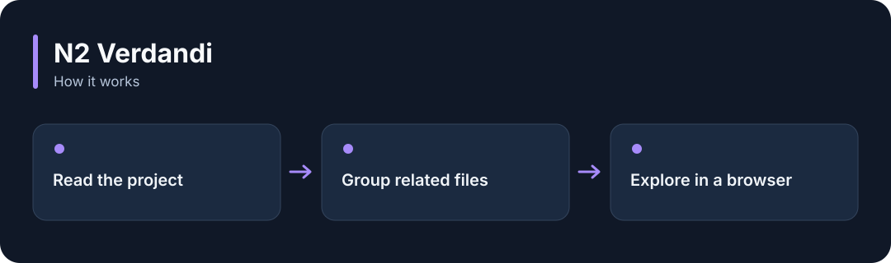

# N2 Verdandi

**Explore related project files as a map and save document knowledge with its source.**

[](https://github.com/choihyunsus/n2-verdandi/releases/tag/v1.0.0) [](https://github.com/choihyunsus/n2-verdandi/blob/main/docs/reference.md) [](https://github.com/choihyunsus/n2-verdandi/blob/main/LICENSE)

[한국어](README.ko.md)



## When to use it

Explore an unfamiliar project or find the files connected to the one you are working on.

Includes a local graph viewer. It handles code relationships and semantic links when embeddings have been prepared. Learned document records retain their verification status.

## Try it

Run `node --version` in a terminal and check for Node.js 22 or later. These commands create a fresh practice folder and install the GitHub release. Keep the example file and database in this folder.

```sh
mkdir n2-verdandi-demo
cd n2-verdandi-demo
npm init -y
npm install https://github.com/choihyunsus/n2-verdandi/releases/download/v1.0.0/n2-verdandi-1.0.0.tgz
```

If installation reports a SQLite build error, you may need your platform’s C/C++ build tools. See the [installation reference](https://github.com/choihyunsus/n2-verdandi/blob/main/docs/reference.md) for platform requirements.

Replace `YOUR_SOURCE_FOLDER` with an existing folder containing source files. Quote paths that contain spaces.

```sh
npx --no-install n2-verdandi --db ./demo.db --project demo --agent assistant --root "YOUR_SOURCE_FOLDER" scan
npx --no-install n2-verdandi --db ./demo.db --project demo --agent assistant serve
```

Check that `scan` reports `index.complete: true`. Open the local URL printed by `serve` to see the file map. Press Ctrl+C in the terminal to stop. See the installation reference if document parsing needs additional setup.

## Using it with Soul

Point connected N2 modules at the same `mimir.db` file. `project` names the work and `agent` names the AI identity you will keep using. Match those values to continue working with the same records. Standalone use follows the same field layout.

## Next steps and reference

The [full reference](https://github.com/choihyunsus/n2-verdandi/blob/main/docs/reference.md) covers app integration, APIs, supported features, recovery and validation. The [release page](https://github.com/choihyunsus/n2-verdandi/releases/tag/v1.0.0) contains the installable version and release notes.

A few terms used in the reference: **MCP** connects tools to an AI app, a **database** stores records, and the **host** is the app that connects and runs this module.

Review the [license](https://github.com/choihyunsus/n2-verdandi/blob/main/LICENSE) for use and redistribution. Dependencies can have their own terms, including commercial-use conditions described in the reference.
